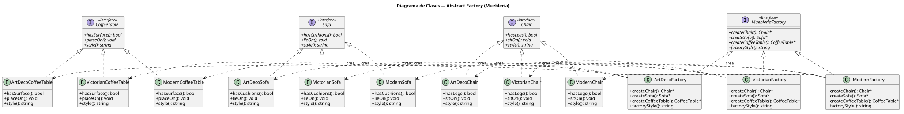
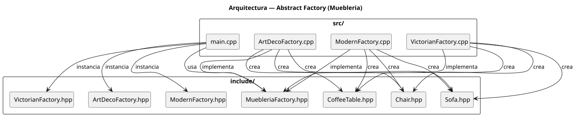

# Practico 09 — STL (Standard Template Library)

> Trabajo práctico de Algoritmos y Estructuras de Datos II — Unidad 04.
> Autor: Lapenta Carlos Matías | Fecha: 2026-09-15

- **Plataforma de entrega:** Google Classroom
- **Formato:** `.pdf` | **Instrucciones:** [Google Drive](https://drive.google.com/file/d/1lih22ExRlgrCnWNrr4tJPglwDO_WptHj/view)
- **Referencia de asignación:** `2026-09-15-lapenta-carlos-matias-algoritmos-y-estructuras-de-datos-ii-practico-09-stl.md`

## Stack Tecnológico

- **Lenguaje:** C++11
- **Compilador:** `g++`
- **Build:** `Makefile`
- **Dependencias:** ninguna (STL únicamente)

## Documentación del sistema

- [`docs/requisitos.md`](docs/requisitos.md) — requisitos funcionales y no funcionales
- [`docs/glosario-de-dominio.md`](docs/glosario-de-dominio.md) — conceptos clave de STL
- [`docs/registro-necesidades.md`](docs/registro-necesidades.md) — análisis de necesidades
- [`docs/diagrams/`](docs/diagrams/) — diagramas de arquitectura y clases

## Arquitectura / Diseño

Se implementan **4 consignas independientes**, cada una como ejecutable separado (`stl_vector`, `stl_iterator`, `stl_map`, `stl_unordered_map`). Cada fuente (`src/consigna0X.cpp`) contiene un `main()` completo que demuestra los pasos requeridos por la spec: inserción, borrado por rango, búsqueda con `find`, iteradores, asignación de `map`, `lower_bound`/`upper_bound`, y conteo de frecuencia con `unordered_map`.





## Scaffolding

```
2026-09-15-practico-stl/
├── Makefile
├── README.md
├── .gitignore
├── include/              (headers; vacío para este lab)
├── src/
│   ├── consigna01.cpp   # vector + find + erase
│   ├── consigna02.cpp   # iterator
│   ├── consigna03.cpp   # map (assign, erase, bounds)
│   └── consigna04.cpp   # unordered_map (conteo Stroustrup)
├── obj/                 # objetos compilados
├── docs/
│   ├── requisitos.md
│   ├── glosario-de-dominio.md
│   ├── registro-necesidades.md
│   └── diagrams/
│       ├── diagrama-clases.puml / .svg
│       └── diagrama-arquitectura.puml / .svg
└── stl_vector / stl_iterator / stl_map / stl_unordered_map
```

## Consignas

| Ejecutable | Consigna | Elementos STL usados |
|---|---|---|
| `stl_vector` | 1 | `vector<int>`, `push_back`, `erase`, `find`, rango `begin()+N` |
| `stl_iterator` | 2 | `vector<int>::iterator`, `begin/end`, `*iter` |
| `stl_map` | 3 | `map<int,string>`, `insert`, `operator=`, `erase`, `lower_bound`, `upper_bound` |
| `stl_unordered_map` | 4 | `unordered_map<string,int>`, `stringstream`, tokenización, conteo |

## Setup y ejecución

### Prerrequisitos

- `g++` con soporte C++11 (`g++ --version`)
- `make`

### Compilar

```bash
make all        # compila los 4 ejecutables
```

### Ejecutar

```bash
make run        # ejecuta secuencialmente los 4 binarios
./stl_vector
./stl_iterator
./stl_map
./stl_unordered_map
```

### Limpiar

```bash
make clean      # elimina binarios y objetos
```

## Referencias teóricas

- [Standard Template Library | Wikipedia](https://en.wikipedia.org/wiki/Standard_Template_Library)
- [C++ Data Structures and STL | W3Schools](https://www.w3schools.com/cpp/cpp_data_structures.asp)
